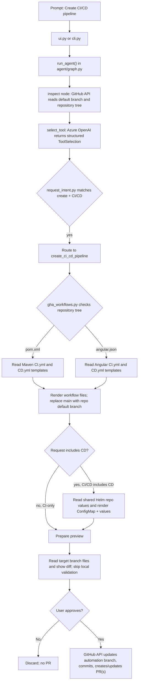

# Deployment Agent Guide

## Overview

The Deployment Agent is a Python application that accepts repository questions
and deployment-change prompts, inspects a GitHub repository, generates
deployment artifacts, validates eligible changes, and prepares pull requests for
review. It uses Azure OpenAI for request understanding and selected
natural-language value extraction, LangGraph for orchestration, GitHub's REST
API for repository access and PR operations, and Python generators/templates
for the files it creates.

The agent does **not** merge pull requests. Generated changes are shown as a
preview first; the user must approve publication in the UI or CLI.

## Architecture

| Component | Responsibility |
| --- | --- |
| Azure OpenAI | Selects a request route, summarizes deployment requirements, creates a structured deployment plan, translates supported natural-language Helm updates, repairs eligible validation failures, and explains unresolved validation errors. |
| LangGraph | Runs repository inspection, request routing, generation, validation, repair, and preview nodes. |
| Python generators | Render deployment files and Dockerfiles from structured plans and repository templates. |
| Helm values tools | Merge shared values, apply prompt overrides, and preserve or remove Key Vault references safely. |
| GitHub integration | Reads repository metadata and files, updates the automation branch, and creates or updates pull requests. |
| Streamlit UI / CLI | Accept prompts, display previews, and request approval before publishing. |
| PyYAML, yamllint, Helm, Docker | Parse/lint YAML, render Helm templates, and perform non-executing Dockerfile checks on the full deployment path. |

### Source layout

```text
src/deployment_agent/
  agent/
    graph.py          LangGraph construction and public run/publish functions
    routing.py        Request classification and deterministic route overrides
    models.py         Typed graph state and structured Azure OpenAI responses
  integrations/
    github_api.py     GitHub REST API client, retries, branch and PR operations
  tools/
    deployment.py       Deployment planning/generation nodes
    deployment_generator.py
                         Pure-Python workflow and basic Helm chart generation
    dockerfile.py       Project detection and Dockerfile template rendering
    gha_workflows.py    Maven/Angular workflow template selection
    helm_repository.py  Reads/writes the shared Helm-Charts repository
    helm_values.py      Helm values rendering, merging, and secret handling
    pull_requests.py    Preview generation, redaction, and publication workflow
    repository.py      Read-only repository Q&A and file reading
    request_intent.py  Request phrase matching
    validation.py      Validation repair loop and error analysis
    yaml_validator.py  YAML, Helm, yamllint, and Docker checks
  cli.py               Command-line entry point
  ui.py                Streamlit chat interface

templates/
  Dockerfiles/         Maven, Angular, and Node server Dockerfiles
  GHA-Workflows/       Maven and Angular CI/CD workflow templates
  Helm-Charts/         Shared ConfigMap and values.yaml templates

tests/                 Pytest unit and integration-style tests
```

## Request workflow

1. The agent validates the `OWNER/REPOSITORY` identifier and inspects the
   repository's default-branch tree.
2. Azure OpenAI proposes a request route. Deterministic intent rules override
   that choice for recognized Dockerfile, CI/CD, Helm, and secret changes.
3. Read-only questions are answered from the file inventory or from up to three
   selected repository files. Selected file content is limited to 12,000
   characters per file before it is sent to Azure OpenAI.
4. Change requests use a template or structured deployment plan to generate
   files.
5. Eligible deployment changes are validated. Some generated YAML/Helm errors
   can receive up to two constrained repair attempts.
6. The agent prepares a diff preview. Detected secret-like values are redacted
   in the preview.
7. After approval, the agent updates or creates the `agent-automation` branch
   and opens or updates the relevant pull request(s).

Repository questions are read-only. Running the agent does not publish changes
until the user approves the preview.

## CI/CD pipeline flow

Example prompt: **“Create CI/CD pipeline”**. Enter the repository separately
as `OWNER/REPOSITORY` in the UI or with `--repo` in the CLI.



### CI/CD files and when they are used

| File/module | When it is used |
| --- | --- |
| `ui.py` or `cli.py` | Receives the repository and prompt, calls `run_agent()`, and displays the generated preview. |
| `agent/graph.py` | Builds the LangGraph and Azure model wrappers. The graph starts at `inspect`, then routes through `select_tool`. It does not publish changes during `run_agent()`. |
| `tools/github.py` and `integrations/github_api.py` | The `inspect` node gets the repository's default branch and recursive file tree from GitHub. For template selection the agent uses tree paths, not `pom.xml` or `angular.json` contents. |
| `agent/routing.py` | Sends the prompt and up to 300 repository paths to Azure OpenAI for a structured tool selection. `request_intent.py` then deterministically overrides the selection for recognized CI/CD wording, including “Create CI/CD pipeline”. |
| `tools/request_intent.py` | Recognizes a change verb and CI/CD or CD intent. Because “CI/CD” contains “CD”, this example takes the CD path as well as the CI path. |
| `tools/gha_workflows.py` | Detects Maven from `pom.xml` or Angular from `angular.json`; errors if neither or both are present. It reads both templates for the detected stack and writes `.github/workflows/ci.yml` and `.github/workflows/cd.yml`, adjusting their default-branch triggers. |
| `templates/GHA-Workflows/Maven/CI.yml`, `CD.yml` | Used when the repository tree contains `pom.xml` and no `angular.json`. |
| `templates/GHA-Workflows/Angular/CI.yml`, `CD.yml` | Used when the repository tree contains `angular.json` and no `pom.xml`. |
| `tools/helm_repository.py` and `tools/helm_values.py` | For a CD request, reads existing shared Helm values from the default and `agent-automation` branches, then renders the shared ConfigMap and values files from templates. |
| `templates/Helm-Charts/configmap.yaml`, `values.yaml` | Local source templates for the shared Helm configuration. |
| `tools/pull_requests.py` | Compares generated content with the target branch and prepares redacted diffs. The CI/CD route skips YAML/Helm/Docker validation. |
| `publish_agent_result()` in `agent/graph.py` and `integrations/github_api.py` | Called only after approval. Updates or creates `agent-automation`, commits changes, and creates or updates the PR for each repository with changes. |

### When Azure OpenAI is called

For the generic **“Create CI/CD pipeline”** prompt, Azure OpenAI is called once
in `routing.py` to select a tool. The following behavior is code/template/API
driven, not generated by the model:

- The project type is detected from repository tree paths.
- CI and CD files are loaded from the matching local templates.
- The default branch is substituted into the templates.
- The shared Helm files are rendered from local templates and existing values.
- No local validation or AI repair runs on this route.

The CD helper only makes another Azure OpenAI call if the prompt also asks for
natural-language Helm parameter changes (for example, “create the CI/CD
pipeline and increase replicas to 3”). That call translates the requested
Helm values into a structured override. A generic CI/CD request has no such
override, so there is no second Azure call.

### What the example produces

For a Maven or Angular repository, this request prepares:

```text
<application-repo>/.github/workflows/ci.yml
<application-repo>/.github/workflows/cd.yml
sandeepshankar1094-creator/Helm-Charts/Application/<prefix>/<repo>/configmap.yaml
sandeepshankar1094-creator/Helm-Charts/Application/<prefix>/<repo>/values.yaml
```

The two workflow files are always generated together by the current template
generator. Since the example is recognized as a CD request, shared Helm
configuration is also prepared. The UI/CLI shows the resulting diffs first;
approving can create or update one PR in each repository. If the repository is
unsupported or the generated content is unchanged, it reports an error or
no-op rather than creating a new change.

## What the agent can do

### Repository questions

- List repository paths.
- Answer questions using the repository file inventory.
- Read up to three exact repository files selected by the agent and answer
  from those contents.

The agent reports when the selected files do not contain enough information;
it does not claim that a file was read unless its contents were supplied to the
answering step.

### Dockerfile generation

For a Dockerfile-only request, the agent detects supported project files and
selects a matching template:

- Maven: `pom.xml`
- Angular: `angular.json` and `package.json`
- Node server: `package.json` with a `start` script

For monorepos, include the project directory in the prompt. Angular output
paths and Node install/build steps are derived from repository metadata where
available. Explicit Dockerfile requests regenerate the Dockerfile from its
template, even if a Dockerfile already exists. This route skips local
validation and prepares a preview containing the Dockerfile change.

### CI/CD workflows

CI/CD workflow templates are available for Maven and Angular repositories. The
agent detects the stack from `pom.xml` or `angular.json`, then renders the
matching templates under `.github/workflows/`. If both stacks or neither stack
are detected, the agent reports an error instead of choosing arbitrarily.

These template routes skip local validation. CD workflows target AKS and include
environment-specific placeholders such as Azure credentials, resource group,
cluster, and deployment settings. Review and configure those values before
merging or running the workflow.

### Deployment configuration

For broader deployment requests, Azure OpenAI creates a structured plan with
the application name, build context, Dockerfile path, container port, replica
count, namespace, chart path, and workflow path. The Python generator creates a
GitHub Actions build/deploy workflow and a basic Helm chart containing chart
metadata, values, Deployment, and Service templates.

The generated workflow builds and pushes an image to GitHub Container Registry
and deploys with Helm. Configure the `KUBE_CONFIG` GitHub repository secret
before using it. The generator does not compile application sources inside the
Docker build; the workflow and project CI must provide any required artifacts.

### Shared Helm configuration

Helm-only requests create **two configuration files** in the shared
`sandeepshankar1094-creator/Helm-Charts` repository:

```text
Application/<repo-prefix>/<repo-name>/configmap.yaml
Application/<repo-prefix>/<repo-name>/values.yaml
```

For example, `java-springboot` maps to
`Application/java/java-springboot/`. These are shared application
configuration files; a Helm-only request does not create a complete standalone
chart directory with `Chart.yaml` and template manifests.

CD requests may prepare one preview for the application repository's workflow
and a separate preview for the shared Helm-Charts repository.

#### Helm values prompts

Natural-language updates are supported for existing template values, including
replicas, autoscaling, resources, ports, container settings, ingress, egress,
Redis, and environment configuration. Use the same key names as the template
when possible. Examples:

```text
Increase replicas to 3.
Update the auto scale min value also to 5.
Set the HTTPS destination to api.example.com and Redis URL to cache.example.net.
```

You can also provide a fenced YAML mapping for exact values:

````text
Update deployment values:
```yaml
app:
  replicaCount: 3
  autoscaleMin: 5
  resources:
    requests:
      cpu: 100m
      memory: 256Mi
  containers:
    port: 9090
ingress:
  enabled: false
```
````

Only keys and nesting present in the configured values template are accepted;
unknown keys are rejected. Natural-language values are translated by Azure
OpenAI into a structured mapping. If you have a required hostname, URL, IP
address, or port, provide it explicitly—the agent is instructed not to invent
infrastructure endpoints. The sample values `poc.ai-agent.com` and
`demo.redis.cache.windows.net` in the template are examples, not production
configuration.

When both natural language and fenced YAML are supplied, explicit YAML
overrides take precedence. Existing shared-repository values are merged before
the prompt overrides are applied.

#### Secret references

Do not put actual secret values in prompts. For example:

```text
Add api-key and database-password to the service.
```

The agent adds entries using the existing Key Vault convention:

```yaml
app:
  containers:
    env:
      - name: api-key
        value: api-key@azurekeyvault
  kvSecrets:
    - api-key
```

The secret itself must be configured separately in Azure Key Vault. Raw secret
values in recognized secret environment variables are rejected.

Existing secret references are merged from both the shared repo's default
branch and `agent-automation`; ordinary values from `agent-automation` take
precedence over conflicting default-branch values. The preview reports
conflicting field paths without displaying their values.

To intentionally remove a secret, use an explicit request such as:

```text
Remove the secret named api-key from Helm values.
```

The generated `values.yaml` records the removal in a YAML comment so a later
update does not restore that reference from the default branch. Explicitly
requesting the secret again clears the removal marker.

## Validation and repair

The full deployment-generation route checks generated files in a temporary
directory:

- PyYAML parses generated YAML.
- `yamllint` checks generated YAML files.
- `helm template` renders the generated chart.
- If a Dockerfile exists in the source repository, Docker Buildx runs
  `docker build --check`.

The Docker check does not execute build steps. The agent fetches the Dockerfile
for this check, not the entire application source, so source-dependent build
behavior is not verified.

For eligible generated YAML/Helm errors, Azure OpenAI can suggest a replacement
for generated YAML files only. The agent validates again after each attempt,
allows at most two attempts, and checks that existing Key Vault references
remain. Missing local tools and other non-repairable environment errors are
reported rather than “fixed” by the model. If validation still fails, the
agent analyzes the errors and does not offer a publishable preview.

Dockerfile-only, CI/CD-template, and Helm-only routes skip local validation.

## Preview, publication, and GitHub behavior

- The UI displays the preview and offers **Create or update pull request** and
  **Discard preview** actions.
- The CLI displays the preview and asks for interactive confirmation by
  default.
- `--yes` opts into immediate non-interactive publication after the diff is
  displayed. Use it only when that behavior is intended.
- Changes use the `agent-automation` branch. Existing branches and open PRs are
  updated; the default branch is not modified directly.
- For changes spanning the application and Helm-Charts repositories, separate
  PRs may be created.
- Unchanged content is not committed again. GitHub reads and idempotent
  updates use bounded retries; non-idempotent POST operations are not blindly
  retried.
- The agent does not merge PRs.

## Setup and configuration

### Requirements

- Python 3.10 or later
- Azure OpenAI resource and deployment
- GitHub token with repository read/write access for each repository the agent
  will update
- `helm`, `yamllint`, and Docker Buildx available on `PATH` for full deployment
  validation

### Install

From the project root in PowerShell:

```powershell
py -m venv .venv
.\.venv\Scripts\Activate.ps1
pip install -r requirements.txt
pip install -e .
Copy-Item .env.example .env
```

Edit `.env` with the actual credentials and settings:

```dotenv
AZURE_OPENAI_ENDPOINT=https://<resource>.openai.azure.com/
AZURE_OPENAI_API_KEY=<key>
AZURE_OPENAI_API_VERSION=2024-10-21
AZURE_OPENAI_DEPLOYMENT=<deployment-name>
GITHUB_TOKEN=<fine-grained-token>
```

For GitHub Enterprise Server, optionally set:

```dotenv
GITHUB_API_URL=https://github.example.com/api/v3
```

The default API URL is `https://api.github.com`. `.env` is ignored by Git; do
not commit credentials.

### GitHub permissions

Grant the token **Contents: Read and write** and **Pull requests: Read and
write** for the application repository and, when shared Helm configuration is
requested, for `sandeepshankar1094-creator/Helm-Charts`. Apply the least
privilege repository scope practical for your deployment.

## Run

### Streamlit chat UI

```powershell
python -m streamlit run src/deployment_agent/ui.py
```

Enter the GitHub repository as `OWNER/REPOSITORY`, submit a prompt, inspect the
preview, and approve or discard it.

### CLI

Interactive:

```powershell
deployment-agent --repo OWNER/REPOSITORY --requirement "Increase replicas to 3"
```

Non-interactive publication:

```powershell
deployment-agent --repo OWNER/REPOSITORY --requirement "Increase replicas to 3" --yes
```

Without `--yes`, a non-interactive CLI invocation does not publish.

## Troubleshooting

| Symptom | Likely cause / action |
| --- | --- |
| Missing Azure environment variable | Check `.env` names and values; restart the UI/CLI after editing it. |
| GitHub `403` or write failure | Verify token access to the source repo and, for Helm changes, the shared Helm-Charts repo. Confirm Contents and Pull requests permissions. |
| `helm` or `yamllint` not found | Install the tool and ensure it is on `PATH`; these tools are needed for the full deployment validation route, not the template-only routes. |
| Dockerfile not found | Add a Dockerfile at the requested path or explicitly ask the agent to create one. General deployment planning does not silently create one unless requested. |
| No preview appears | The request may be read-only, validation may have failed, or generated files may already match the target branch. Check the response and validation analysis. |
| Request was answered from a repository file instead of changing Helm values | Name the setting clearly or say “update Helm `values.yaml`”; supported natural-language settings include replicas, autoscaling, resources, ports, endpoints, and environment values. Exact fenced YAML is the most deterministic format. |
| CI/CD project type not detected | The current workflow templates support Maven (`pom.xml`) and Angular (`angular.json`). Mixed or unsupported repositories require a suitable template or a more specific request. |
| Validation errors remain after repair | Confirm local tools and source files are available. The repair loop is bounded and limited to generated YAML; review the reported errors and fixes before retrying. |

## Privacy and safety notes

- Never place actual API keys, passwords, tokens, or other secret values in
  prompts.
- Store credentials in `.env` or the appropriate GitHub/Azure secret store, not
  in generated files.
- Repository file contents selected for a question and prompts for AI-assisted
  planning/repair are sent to the configured Azure OpenAI deployment. Avoid
  requests that would send files your organization does not permit to share
  with that deployment.
- Repository paths and file contents are treated as untrusted input by the
  model prompts; generated changes still require preview and approval.
- Preview redaction is based on recognized secret-like field names and
  Key Vault/GitHub secret-reference patterns. It is a safeguard, not a reason
  to include real secrets in prompts or source files.

## Development and tests

Run the test suite:

```powershell
python -m pytest -q
```

Compile the Python package and tests:

```powershell
python -m compileall -q src tests
```

Dependencies and project metadata are defined in `pyproject.toml` and
`requirements.txt`. The existing [README](README.md) provides the shorter
quick-start and operational summary.
